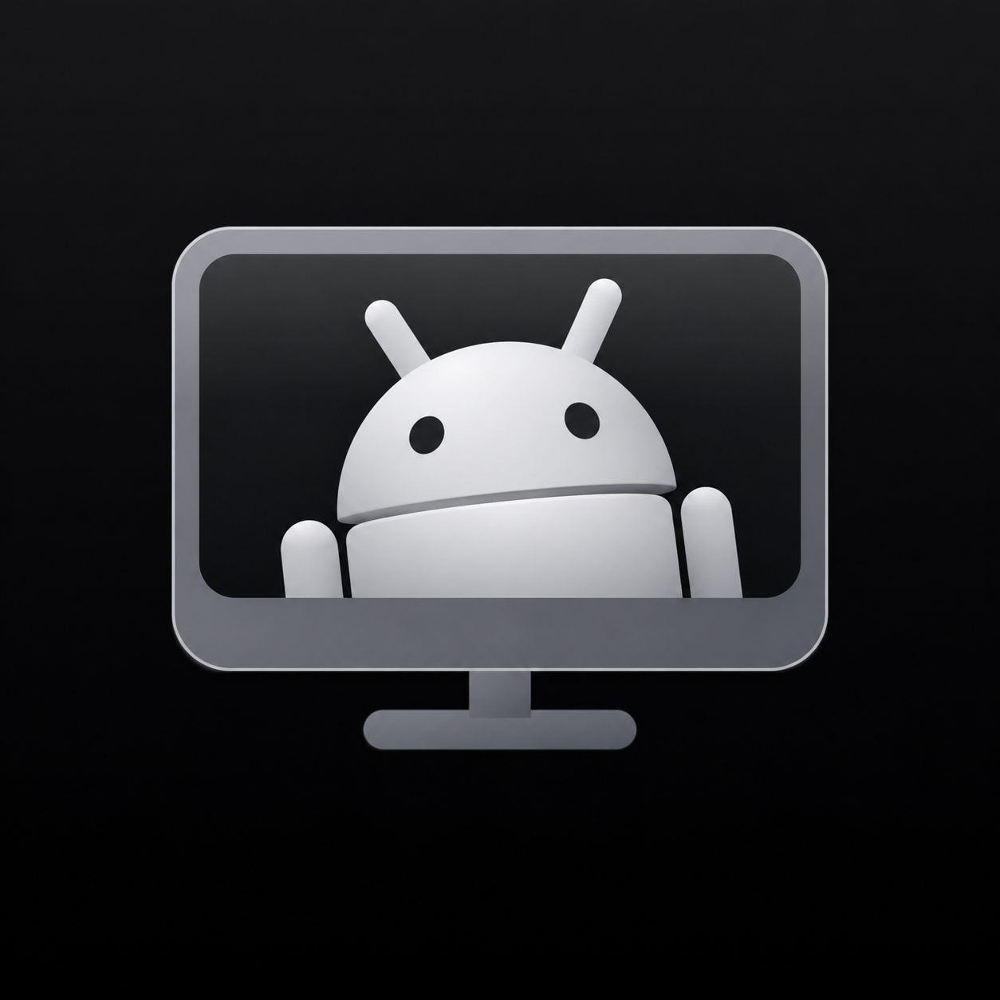
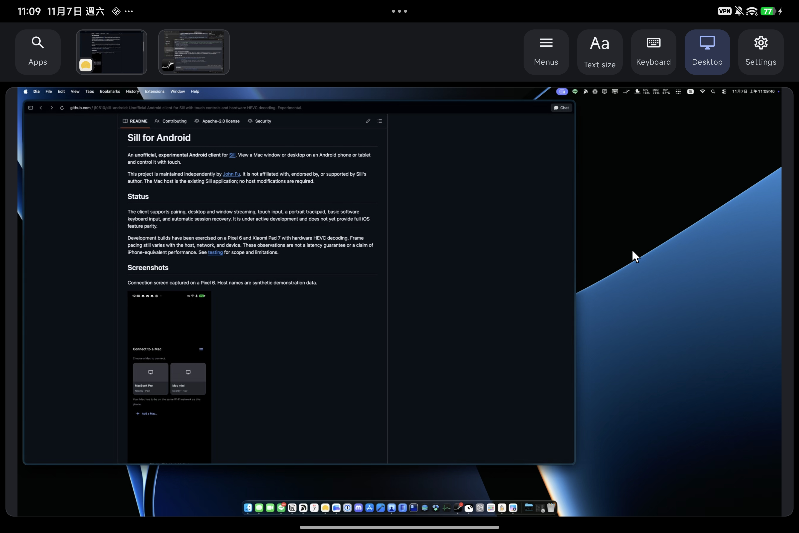

<p align="center">
  
</p>

# Sill for Android

An **unofficial, experimental Android client** for [Sill](https://github.com/Saffsanity/sill).
View a Mac window or desktop on an Android phone or tablet and control it with touch.

This project is maintained independently by [John Fu](https://github.com/jf0510).
It is not affiliated with, endorsed by, or supported by Sill's author.
The Mac host is the existing Sill application; no host modifications are required.

## Status

The client supports pairing, desktop and window streaming, touch input, a portrait
trackpad, software and hardware keyboard input, clipboard sharing, AAC-ELD audio,
full-screen viewing, Picture in Picture, and automatic session recovery. It is
under active development and does not yet provide full iOS feature parity.

Development builds have been exercised on a Pixel 6 and Xiaomi Pad 7 with hardware
HEVC decoding. Frame pacing still varies with the host, network, and device.
These observations are not a latency guarantee or a claim of iPhone-equivalent
performance. See [testing](docs/testing.md) for scope and limitations.

## Screenshots

Mac desktop sessions on a Pixel 6 and Xiaomi Pad 7.

<table>
  <tr><th>Pixel 6</th><th>Xiaomi Pad 7</th></tr>
  <tr>
    <td></td>
    <td></td>
  </tr>
</table>

## Requirements

- Android 11 (API 30) or later, with a compatible HEVC decoder.
- A Mac running [Sill](https://getsill.app/). The 0.2.0 update was checked against the upstream 0.6.2 development host;
  newer features are enabled only when the host advertises them.
- Both devices reachable on the same local network. Discovery requires multicast
  traffic to be permitted on that network.

The Mac needs the permissions requested by Sill, including Screen Recording and
Accessibility. Refer to the upstream documentation for Mac setup.

## Build and install

Use JDK 17, Android SDK Platform 36, and Build Tools 36.0.0. Set `ANDROID_HOME` to
your SDK directory or create an untracked `local.properties` containing `sdk.dir`.
The Gradle wrapper downloads the pinned Gradle distribution on first use.

```sh
./gradlew :app:testDebugUnitTest :app:lintDebug :app:assembleDebug
adb install -r app/build/outputs/apk/debug/app-debug.apk
```

The application ID is `io.github.jf0510.sill`; its launcher label is **Sill**.
The connection screen identifies it as an unofficial Android client. A locally
built debug APK uses the developer's Android debug signing key. Install updates
using the same signing key to retain application data and pairing.

Signed preview APKs are available from [GitHub Releases](https://github.com/jf0510/sill-android/releases).
Download the `.apk` asset from the desired version and allow installation from
your browser or file manager when Android prompts. There is no Play Store listing.
Release APKs use a stable signing key so later releases can update an existing
installation. A debug build uses a different key; replacing it with a release
APK requires uninstalling the debug build and pairing again. There is no in-app
auto-updater; download subsequent versions from Releases.
`./gradlew :app:assembleRelease` produces an unsigned release APK; signing keys
and passwords must remain outside the repository.

Release signing certificate SHA-256:

```text
b07156eb35bb8f5f5e200a001af573f9f0799fb7ea2e5d763b252caac9f1f491
```

## Connect

1. Start Sill on the Mac and the Android client on the same network.
2. Select the Mac in the connection screen. Enter the 12-digit pairing code shown
   on the Mac. If necessary, open **Pair iPhone or iPad…** in the Mac's Sill menu.
3. After pairing, the client joins the active source or selects Desktop when no
   source is active. Use a window thumbnail or **Desktop** to change the source.

If discovery is unavailable, **Add a Mac** accepts an address and port. Use the
Mac's actual TLS listener. Port 7455 is the upstream remote listener and requires
Remote Access on the Mac; it is not a universal local-discovery port.
Saved Macs learn signed remote addresses and retain previously learned VPN routes
when a later list omits them. Nearby discovery recognizes newly paired Macs by their
pairing recognition tag and refreshes their LAN address; every session still pins
the Mac's identity key. Pairings made before 0.2.0 may need pairing again to learn
that recognition key. Remote access requires enabling it on the Mac and a working
network or VPN route on both devices. There is no relay service in this client.

**Scan QR** uses the camera only when you request a scan. **Pairing link** also
accepts a `sill://pair` link from the Mac; review the Mac name and confirm before
pairing. QR/link pairing validates the Mac identity and its mutual pairing proof.

## Controls

| Surface or control | Behavior |
| --- | --- |
| Picture | Tap to click; hold to right-click; swipe to scroll |
| Picture zoom | Pinch to zoom; two-finger pan while zoomed |
| Portrait trackpad | Slide to move; tap to click; two-finger tap to right-click; two-finger scroll |
| Trackpad drag | Hold to drag (configurable), or tap then touch again within 300 ms and move |
| Three/four fingers | Swipe for Spaces, Mission Control or App Exposé; pinch/spread for Apps/Show Desktop |
| Hardware input | HID keyboard shortcuts and held keys; mouse buttons/wheel; stylus tip drag and hover |
| Desktop | Tap again to cycle the Mac’s displays when the host advertises multiple displays |
| Full Screen | Settings → Full Screen; swipe in from the left edge, press Back or use Show controls to return |
| Picture in Picture | Enable in Settings, then go Home or select Open Picture in Picture |
| Clipboard | Mac copies arrive in the foreground; Paste on Mac sends text and pastes after acknowledgement |
| Sound | Send audio changes the host setting; Mute affects only this device |
| Window thumbnail | Select a window; long-press for window commands |
| Apps | Search open windows and launch installed Mac applications |
| Keyboard | Open the Android software keyboard; use the shortcut row for additional keys |
| Settings | Adjust supported host settings and local scrolling direction |

Settings that affect capture quality, resolution, or frame rate are **shared Mac
stream settings** and may affect other connected clients. If an HEVC picture
exceeds the decoder's size limit, the client can request Standard resolution.
It does not automatically restore the previous Retina setting.

## Known limitations

- Frame delivery can be uneven, including on devices with hardware decoding.
- Audio requires a device decoder advertising AAC-ELD. Audio and video are not
  synchronized to a shared presentation clock; audible quality and latency vary.
- Hardware keyboard layouts, stylus pressure/tilt, vendor trackpads, CJK IMEs and
  accessibility need broader device coverage. Stylus input currently maps to pointer
  events; Android system gestures may reserve some multi-finger gestures.
- PiP availability and background behavior depend on the Android device. Clipboard
  reads happen only on an explicit Paste action; sharing stops in PiP/background,
  on a locked Mac or while another user has its screen.
- Apple Direct Wireless (AWDL), Apple USB discovery and automatic cable pairing
  are unavailable in this Android transport. LAN and routed VPN connections are used.
- The 0.2.0 live interoperability gate used Xiaomi Pad 7 with an upstream synthetic
  host over adb reverse. Pixel 6, real WAN/VPN routing, physical keyboard/stylus
  combinations and camera QR scanning were not re-tested in this release. Phone
  layout checks on the tablet are not a substitute for testing a physical phone.

See [architecture and provenance](docs/architecture.md),
[contributing](CONTRIBUTING.md), and [security](SECURITY.md).

## Privacy

Camera access is used only for requested QR scans and no camera images are uploaded.
Clipboard text is exchanged only with the selected paired Mac while sharing is enabled.
The client discovers devices on the local network and connects directly to the
Mac selected by the user. It has no analytics, advertising SDK, account service,
or relay server. Pairing records and preferences remain in application storage;
the device private key remains in Android Keystore. Android application backup
is disabled. Diagnostic logs may contain host names, addresses, and device
information; redact these before sharing a bug report.

## License and attribution

[Apache License 2.0](LICENSE). Sill was created by **Noah Saffer**.
This Android implementation adapts the upstream protocol and interface behavior
from the initial commit `41e8cb8801f8e9d387e27a0d498dee193d17e9ec`
and the 0.2.0 update baseline `bf69067fe60348bfcf3d617086a8589fbdf8dbb6`.
The launcher icon and project logo adapt the upstream Sill icon with a grayscale
Android robot. See [icon sources and attribution](docs/branding.md).

The Android robot is reproduced or modified from work created and shared by Google and used according to terms described in the Creative Commons 3.0 Attribution License (https://creativecommons.org/licenses/by/3.0/).

See [NOTICE](NOTICE) for upstream attribution and modifications, and
[third-party notices](app/src/main/assets/THIRD_PARTY_NOTICES.txt) for dependencies.
These notices are also bundled in the APK and available under Settings →
**About and open-source licenses**. No endorsement or trademark rights are claimed.
